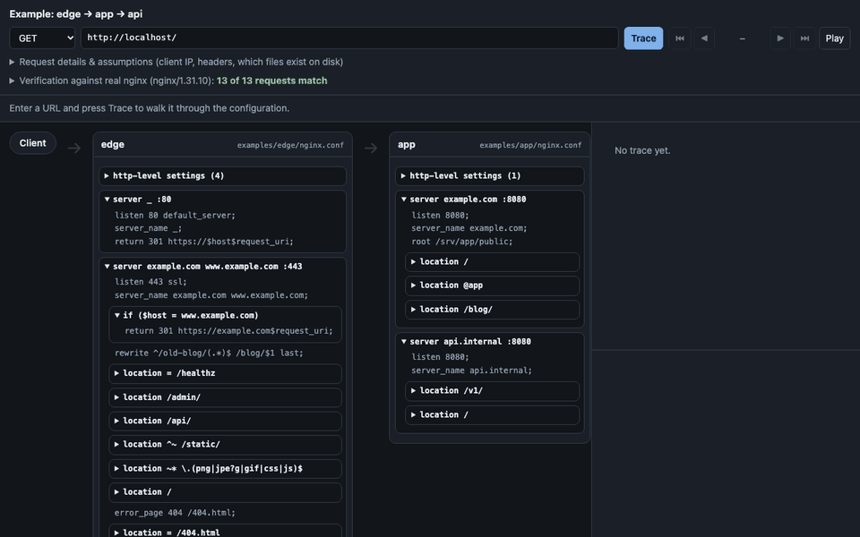
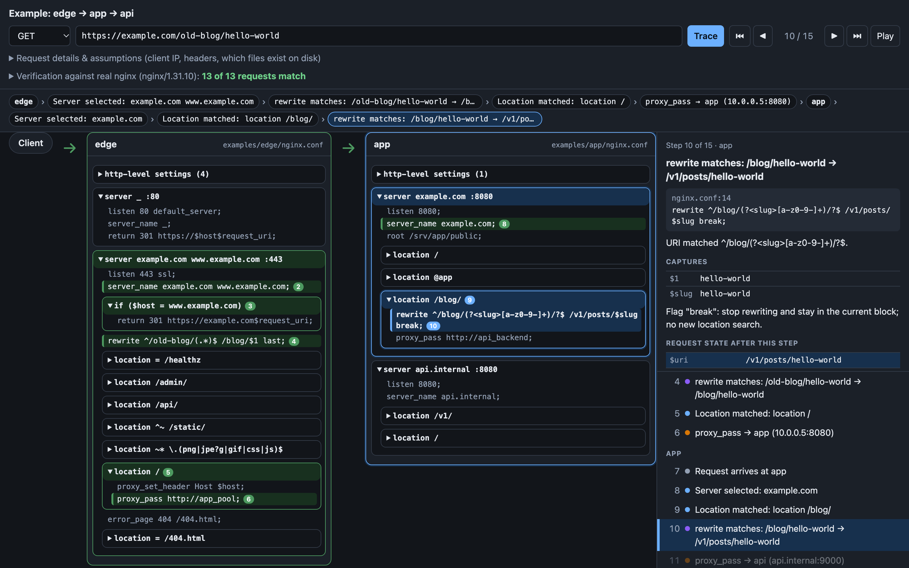
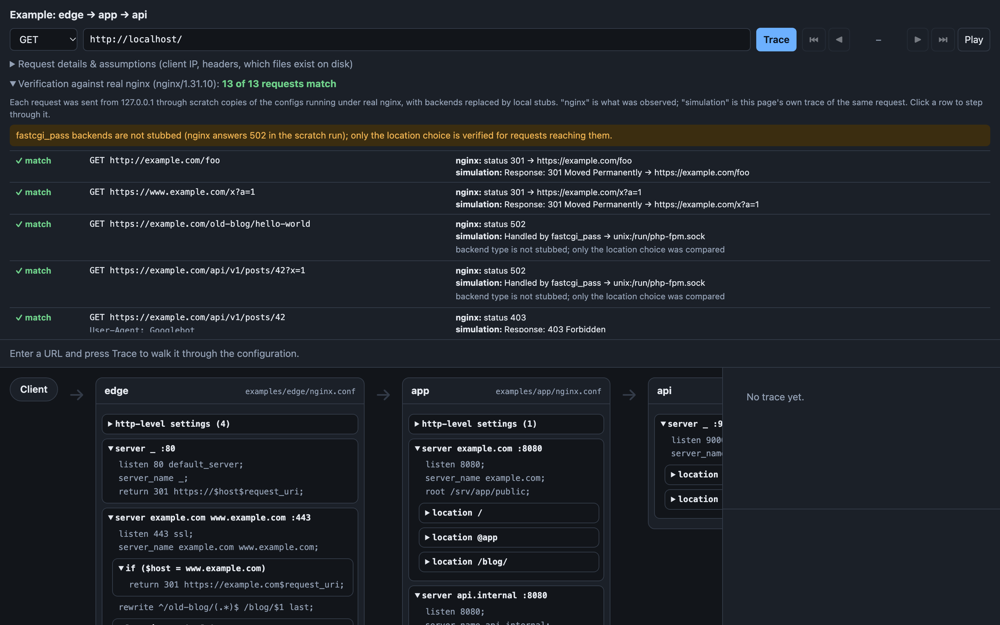

# nginxviz

<p align="center">
  
</p>

[](https://github.com/ryanjjohnson/nginxviz/actions/workflows/release.yml)
[](https://github.com/ryanjjohnson/nginxviz/actions/workflows/security.yml)
[](https://github.com/ryanjjohnson/nginxviz/releases/latest)
[](LICENSE)
[](#the-prompt)

Shows what nginx will do with a URL. Give it one or more nginx configurations and it writes:

- `nginx-flow.html`: one self-contained interactive page. Enter a URL and step it through
  server selection, rewrites, `if`, location matching, access rules, `try_files`, `error_page`
  and `proxy_pass`, from one nginx instance to the next.
- `nginx-flow.md`: a Mermaid flowchart / decision tree of the same configs.

With `-verify` it also replays a list of URLs against a real nginx and shows, per URL, whether
nginx and the page agree.

One static binary with no dependencies, written in Go using only the standard library. The page
loads nothing from anywhere: no scripts, fonts, styles or images, and its
Content-Security-Policy forbids every network request.

## The Prompt

This program was written by Claude. The request that started it, as typed:

> i want a command line tool, written in Go, that takes nginx configuration and produces an
> interactive diagram of it (save as html + css + javascript + whatever) that allows me to enter
> a URL and play it stepwise through the nginx config's rules, show the path through the rule
> workflow and the details at each step. i should be able to specify multiple servers with
> separate configs, such as Main RP -> upstream 1 -> upstream 2. also produce a markdown file
> with a mermaid flow diagram/decision tree. i want as few dependencies as possible. this is
> going to be used in sensitive environments.

The follow-up question was "how do you know what nginx is going to do?", and the honest answer
(it didn't, with certainty) is why `-verify` exists. The tests, the hardening described under
[Security](#security), the release pipeline and this section were later requests in the same
conversation.

## What it looks like

A trace in progress. Each step names the directive that decided it, with file and line, and
shows the request as it stands after that step:



After a `-verify` run, the page lists every replayed request with what nginx did and what the
page's own simulation says:



`python3 docs/make-demo.py` regenerates these pictures from `examples/out/nginx-flow.html` by
driving the real page in headless Chrome.

## Install

Download the binary for your platform from the
[latest release](https://github.com/ryanjjohnson/nginxviz/releases/latest), put it somewhere on
your PATH and name it `nginxviz` (on Mac and Linux, also `chmod +x nginxviz`):

| Machine | File |
|---|---|
| Mac (Apple silicon / Intel) | `nginxviz-darwin-arm64` / `nginxviz-darwin-amd64` |
| Linux, Intel/AMD | `nginxviz-linux-amd64` |
| Linux, 64-bit ARM | `nginxviz-linux-arm64` |
| Linux, 32-bit ARM | `nginxviz-linux-armv7` |
| FreeBSD | `nginxviz-freebsd-amd64` |
| Windows | `nginxviz-windows-amd64.exe` |

Every release binary carries signed build provenance: proof that it was built by this
repository's GitHub Actions workflow from the tagged commit. To check a download, with the
[GitHub CLI](https://cli.github.com) installed:

```bash
gh attestation verify nginxviz-linux-amd64 --repo ryanjjohnson/nginxviz
```

`SHA256SUMS.txt` in each release covers accidental corruption if you would rather not install
anything.

On a Mac, a binary downloaded in a browser is quarantined and macOS will refuse to run it.
Clear that with `xattr -d com.apple.quarantine nginxviz`, or build from source.

## Build

```bash
sh build.sh
```

```bash
sh build.sh release
```

The first builds `./nginxviz` for this machine; the second cross-compiles every platform into
`dist/`. Needs Go 1.21 or later. There are no modules to download and no `go.sum`.

Every push to `main` that changes the program publishes a new release automatically, bumping
the patch version. To choose the version yourself, push a tag such as `v0.2.0`.
The `security` workflow runs `govulncheck`, CodeQL (Go and the page's JavaScript), the
hostile-input tests, a `-verify` run against a real nginx and a fuzzing pass on every push and
once a week.

## Test

```bash
go test ./...
```

The tests need no nginx. They cover the config parser, the Mermaid output
(`examples/out/nginx-flow.md` is the expected output for the example configs), the config
rewriting done by `-verify`, and every attack listed under [Security](#security). They do not
run the page's JavaScript simulator: that is what `-verify` checks.

## Use

```
nginxviz [flags] [name=]nginx.conf [[name=]other.conf ...]
```

The first config is the entry point. Use `-addr name=host[:port]` to say which addresses (as
they appear in `proxy_pass` / `upstream` blocks) reach which config, so the trace can follow the
request from one instance to the next:

```
nginxviz -o out \
  -addr app=10.0.0.5:8080 -addr api=api.internal:9000 \
  edge=examples/edge/nginx.conf app=examples/app/nginx.conf api=examples/api/nginx.conf
```

`include` directives (with globs) are followed. Relative paths resolve against the directory of
the top-level config file, and an include may only read files inside that directory; anything
else is skipped with a warning. If your config includes files from elsewhere, name the directory
with `-include-dir` (repeatable). Fragments (bare `server` or `location` blocks) work.

`nginxviz -h` lists every flag.

## Verify against real nginx (optional)

The page's simulator is a re-implementation of nginx's rules. To check it against nginx itself,
give `-verify` a file of URLs:

```
nginxviz -verify examples/urls.txt -nginx /usr/sbin/nginx -o out [-addr ...] edge=... app=... api=...
```

```
# urls.txt: one request per line
https://example.com/api/v1/posts/42?x=1
POST https://example.com/blog/x | User-Agent: Googlebot | Cookie: a=b
```

What happens:

1. A scratch copy of each config is written to a temp directory: listen addresses become free
   ports on 127.0.0.1, log, pid and temp paths move into the temp directory, TLS uses a
   throwaway certificate, and `proxy_pass`/`upstream` targets point at the other scratch
   instances or at local stub backends. Only directives on a fixed list are copied (see
   [Security](#security)). Your real config files are never modified.
2. One nginx process per config is started, each request is sent, and nginx's debug log is read
   for the locations it chose. Stubs record the request that reached each backend. Everything is
   then stopped and deleted (`-keep` keeps the directory for inspection).
3. The observations are embedded in the HTML. The page runs its own simulation of each request
   and lists, per URL, whether nginx and the simulation agree on: locations chosen in every hop,
   final status, redirect target, and the request line and Host header sent to the backend.

The example configs and their 13 requests have been checked this way against nginx 1.24 on Linux
and nginx 1.31 on a Mac; both agree with the simulation on all 13.

Limits of verify:

- Requests come from 127.0.0.1, so `allow`/`deny` are evaluated for that address.
- Use the same nginx version and modules as production. Location checks need a binary built
  `--with-debug` (most distribution packages are); without it only status, redirects and backend
  requests are compared.
- Directives that are not on the list are left out and named in the page. That includes `ssl_*`,
  caching, rate limiting, logging and anything from a third-party module, so their effect is not
  exercised. `-verify-allow NAME` copies one more directive, on your say-so.
- FastCGI/uwsgi/SCGI/gRPC backends are not stubbed; for requests that end there, only the
  location choice is compared.
- Static files are looked up on the machine running verify, so their status reflects that
  machine's disk.
- `$server_port` shows the scratch port. `proxy_pass` with variables in the host, and Lua, are
  not supported.
- If nginx rejects the scratch config (for example a variable set by a directive that was left
  out), the error is printed and the scratch directory is kept.

## Security

nginx configs get pasted into tickets, copied from other teams and checked out of repositories
nobody has read, so nginxviz treats every config file and URL list as hostile. This matters most
for `-verify`, where a real nginx runs something derived from that config.

**What a config cannot do**

- **Corrupt memory or run code in nginxviz.** It is Go with no C code, no `unsafe` and no
  third-party packages. Without `-verify` it starts no other program.
- **Read files you did not name.** `include` only reads regular files inside the directory of
  the config you passed (or a directory you allowed with `-include-dir`), judged after symbolic
  links are resolved. `include /etc/shadow;`, `include ../../home/*/.ssh/*;` and a link that
  points outside are skipped with a warning. Devices and pipes are never opened, so
  `include /dev/zero;` cannot hang it. This matters because included text is copied into the
  outputs.
- **Reach the network.** Without `-verify`, nginxviz opens no socket at all. With it, every
  listener, stub and request is on 127.0.0.1.
- **Make the scratch nginx do anything but route requests.** A scratch config is assembled from
  a list of about 110 directives known to be safe to run (`verifyAllowed` in `verify.go`), not
  by removing known-bad ones. So `load_module`, `perl_set`, `js_import`, Lua in any form,
  `proxy_store`, `dav_methods`, `error_log syslog:…`, `resolver`, `ssl_engine`, core-dump and
  profiler paths, shared-memory and hash sizes are simply not there, and the page names what was
  left out. Lua makes verify refuse outright. Addresses are rewritten, never copied: a `listen`
  becomes `127.0.0.1:port`, an upstream server or `proxy_pass` host becomes another scratch
  instance or a stub, and anything malformed, misplaced or not a plain host goes to a closed
  port. Redirects are recorded, not followed.
- **Inject into the page.** Config text reaches the page as JSON inside the page's one script
  (with `<`, `>` and `&` escaped) and is shown through `textContent` only. The
  Content-Security-Policy is `default-src 'none'` and names that script by its SHA-256 hash, so
  no other script could run even if markup did get in. Maps keyed by config text do not inherit
  from `Object.prototype`, so a variable called `__proto__` is just a variable.
- **Inject into the Mermaid file.** Labels cannot end their quotes, the diagram or the code
  fence; text outside the diagram is escaped or in code spans, so GitHub or GitLab render a
  diagram and plain text, nothing else.
- **Take over the terminal.** Warnings and errors quote config text, so control characters,
  escape sequences and bidirectional overrides are replaced before anything is printed.
- **Exhaust the machine.** Everything a file can make nginxviz spend is capped (`limits.go`):

| Limit | Value | Stops |
|---|---|---|
| One config file | 8 MB | huge files; real configs are kilobytes |
| A config with all its includes | 32 MB, 2,000 files | include loops and fan-out (a file that includes itself twice is 2^20 parses otherwise) |
| Include nesting | 20 | include cycles |
| Block nesting | 64 | stack exhaustion from `a { a { a { …` |
| Directives / arguments per directive | 200,000 / 4,096 | memory, and the size of the outputs |
| Warnings / one message | 200 / 2,000 bytes | flooding the terminal |
| URL file | 4 MB, 5,000 requests, 16 KB per line | endless verify runs |
| Listen ports per config / stub backends | 64 / 256 | opening sockets without bound |
| One response read / nginx log per request | 16 MB / 32 MB | a config that serves something endless |
| One request / `nginx -t` | 15 s / 60 s | hangs |

**The scratch TLS certificate.** `-verify` talks TLS to its own scratch nginx. It does not switch
certificate checking off to do so: the throwaway certificate is made for the host names in your
URL list, and the client trusts that one certificate and nothing else.

**How this is checked.** `security_test.go` holds one test per attack: includes that leave the
config directory by absolute path, `..`, glob or symbolic link; devices; include bombs; deep
nesting; oversized files, directive and argument counts; escape sequences in every message;
markup, script and fence-breaking text in the page and the Mermaid file; a config full of
dangerous directives run through the scratch rewriter; Lua; listener and stub limits; and the
TLS certificate being verified rather than skipped. Six fuzz targets cover every way data gets
in and out: `FuzzParse` (config text and includes, with a file it must never reach),
`FuzzScratchConf` (whatever the config, the copy nginx would run holds only listed directives,
only 127.0.0.1 addresses and only scratch paths), `FuzzHTML`, `FuzzMermaid`, `FuzzCases` (the
URL file) and `FuzzClean` (terminal and Markdown text). Each also fails on an input that is
merely slow. CI runs all of it on every push, on 64-bit and 32-bit, with the race detector, plus
`govulncheck`, CodeQL and a `-verify` run against a real nginx, and a longer fuzzing pass
weekly. To fuzz with your own configs as seeds:

```bash
NGINXVIZ_FUZZ_SEEDS=/etc/nginx go test -run '^$' -fuzz '^FuzzScratchConf$' -fuzztime 10m .
```

**What is not covered.**

- **The page's simulator is not fuzzed.** It is JavaScript, and the fuzzers are Go. It runs in
  the browser's sandbox with no network, so the worst a config can do there is be traced wrongly
  or make the tab slow: a regex from the config is run by the browser's regex engine, and one
  written to backtrack forever will hang the tab when you trace a URL against it.
- **The outputs contain your configuration.** `nginx-flow.html` and `nginx-flow.md` hold the
  full text of every config and included file. Handle them like the configs themselves.
- **`-verify` runs the nginx binary you name**, with your permissions. The list of directives
  limits what a config can ask of it; it does not protect you from a bug in nginx itself, or
  from a config that sends it into a loop of internal redirects until the request times out.
  `root` and `alias` are copied, so the scratch nginx can read (not write) any file you can, and
  serve it to nginxviz on 127.0.0.1, which discards it.
- **`-verify-allow` and `-include-dir` are your decisions.** They widen what a config may do.
- **Other local users.** Scratch listeners are on 127.0.0.1 for a few seconds; another user on
  the same machine could connect to them. The scratch directory itself is private to you.
- Release binaries carry signed build provenance (see Install), which shows where a binary was
  built, not that the source is free of bugs; they are not notarised by Apple or signed for
  Windows SmartScreen.

Found a problem? Please open an issue, or email the address in the commit log for anything
sensitive.

## What the simulator models, and what it assumes

Modelled: `listen`/`server_name` selection (exact, wildcard, regex, default), `location` matching
(`=`, `^~`, `~`, `~*`, prefix, nested, named), `rewrite` (`last`/`break`/`redirect`/`permanent`),
`return`, `set`, `if`, `map`, `allow`/`deny` (IPv4), `internal`, `try_files`, `index`,
`root`/`alias`, `error_page`, `proxy_pass` URI rewriting, `proxy_set_header`, `upstream`.

Assumptions, always stated in the step where they apply:

- Disk contents are unknown: list existing files in the page to resolve `try_files`,
  `if (-f …)`, `index` and static serving.
- Authentication, rate limits and `auth_request` are shown and assumed to pass.
- For an `upstream` group the first non-backup server is followed.
- Regexes are run by the browser's engine; PCRE-only syntax that cannot be translated is flagged
  and treated as not matching.
- Variables the tool does not know are treated as empty and listed.
- Lua blocks, njs, `geo`, `split_clients` and third-party modules are not evaluated.

It is an analysis aid, not a replacement for `nginx -t` or a test request.

## Layout

- `main.go`: flags, building the bundle of configs, writing the two outputs
- `parser.go`: the nginx config parser and `include` handling
- `limits.go`: the hard limits on what input may cost, and message cleaning
- `mermaid.go`: the Mermaid flowchart
- `verify.go`: scratch configs, stub backends, running nginx, reading what it did
- `viewer.html`: the page, including the simulator; embedded in the binary
- `security_test.go`: hostile-input tests and fuzz targets
- `parser_test.go`, `mermaid_test.go`, `verify_test.go`, `main_test.go`: unit tests
- `examples/`: three configs (edge, app, api), a URL list, and the outputs they produce
- `docs/`: the pictures above and `make-demo.py`, the script that regenerates them
- `testdata/fuzz/`: inputs the fuzzers once failed on, kept as regression tests

## Licence

MIT. See [LICENSE](LICENSE).
