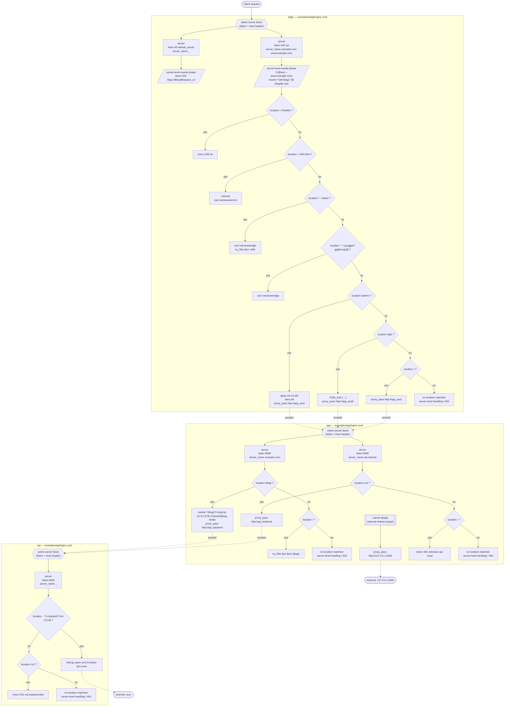

# Example: edge → app → api

Generated by `nginxviz`. Hops, in order:

1. **edge** — `examples/edge/nginx.conf` (reachable as: `edge`)
2. **app** — `examples/app/nginx.conf` (reachable as: `app`, `10.0.0.5:8080`, `10.0.0.6:8080`)
3. **api** — `examples/api/nginx.conf` (reachable as: `api`, `api.internal:9000`)

## Reading the diagram

- Diamonds are location tests, shown in the order nginx effectively decides them:
  exact (`=`), then `^~` prefixes, then regexes in file order, then plain
  prefixes (longest first).
- This linear order is a simplification. Precisely: nginx first finds the
  *longest* matching prefix location; only if that one is `^~` are regexes skipped.
  A shorter `^~` location does not suppress regexes when a longer plain prefix
  also matches. Use the interactive HTML trace for the exact behaviour on a given URL.
- Dotted edges cross from one nginx instance to the next.
